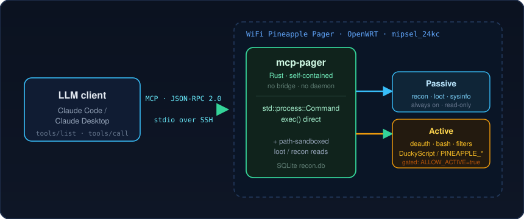

<div align="center">


**Your LLM, holding a Wi-Fi + Bluetooth scanner.**
A tiny Rust [MCP](https://modelcontextprotocol.io) server that lets Claude *see* what the
Hak5 WiFi Pineapple Pager sees — nearby APs, clients, Bluetooth devices, captured
handshakes, loot — and *act* on an authorized engagement.

</div>

> [!WARNING]
> **Authorized use only.** This payload controls a wireless auditing device and
> exposes full device control (including deauth and arbitrary root commands) to your
> MCP client. The server is reached over SSH — whoever can launch it already has a
> root shell on the Pager — so access control is your SSH access. Run it only against
> networks, clients and devices you own or are explicitly authorized to test.

---

## Why this is cool

Point Claude at your Pager over SSH and ask in plain language:

> *"What APs are around me right now on 5 GHz?"*
> *"Lock to the channel of the strongest one and tell me the moment a handshake lands."*
> *"Which of my associated clients just pulled a DHCP lease, and what's its IP?"*

Claude calls the right tools, reads the recon database, watches the loot folder,
and buzzes the device when something interesting happens — no web UI, no tunnel,
no daemon. One self-contained **~300 KB** binary that runs straight over SSH stdio.

---

## What it can do

Every tool is always advertised and callable — the SSH login is the trust boundary.
Tools fall into two groups by what they touch.

### 🟦 Recon, loot & introspection — nothing touches the air

| Tool | What it gives Claude |
|------|----------------------|
| `system_info` | kernel, uptime, storage, memory, firmware |
| `recon_context` | the AP/client this payload was launched against |
| `recon_list` | survey nearby **APs** or **clients** (band / min-signal / age filters; defaults to the last 120 s) |
| `recon_ap_detail` | everything about one BSSID — SSIDs, band, security, signal, handshakes, stations |
| `handshakes` | captured WPA handshakes; `since_seconds` enables **new-handshake polling** |
| `handshake_stats` | count `.22000` / `.pcap` / `.pcapng` loot, optional MAC filter |
| `channel_lock` / `channel_unlock` | pin to a channel (or an AP's channel) to catch handshakes, then resume hopping |
| `list_loot` / `read_loot` | browse and read loot files (sandboxed, size-capped) |
| `find_client_ip` | resolve an associated client's IP from ARP/DHCP |
| `recon_set_bands` / `recon_new_session` | choose 2.4/5/6 GHz bands · start a fresh recon session |
| `list_filters` | show device (MAC) or network (SSID) filter lists |
| `pcap_control` | start/stop the optimized Wi-Fi pcap log |
| `bt_status` | **blue5** Bluetooth scanner / adapter state — LE+Classic mode, device counts, DB/WiGLE logging, GPS |
| `bt_list` | survey nearby **Bluetooth** devices (BLE + Classic) with type / RSSI / age / named / connectable / company filters |
| `bt_device_detail` | everything about one BT device — vendor, transport, Class-of-Device, appearance, services, raw mfr/service data |
| `bt_scan_config` | tune the live blue5 scan (active LE, Classic inquiry, LE/Coded PHY, drop random, name requests, round/pause) |
| `bt_recon_new` / `bt_recon_end` | start a fresh BT database scan · end the current one |
| `bt_wigle` | toggle WiGLE CSV logging of Bluetooth devices |
| `notify` | buzz the operator on the Pager (log / alert / vibrate / LED / ringtone) |

### 🟧 Device control & active RF — use only on an authorized engagement

> Full device control and frames on the air. The SSH login already grants all of
> this; these tools just expose it structured.

| Tool | What it does |
|------|--------------|
| `bash` | run arbitrary shell command(s); DuckyScript / `PINEAPPLE_*` are on `PATH` |
| `duckyscript` | run any DuckyScript / `PINEAPPLE_*` command by name with args |
| `deauth_broadcast` | deauth **all** clients on an AP (deauth/disassoc, or CSA) |
| `deauth_clients` | directed deauth of **specific** client MACs (feed from `recon_list`) |
| `device_filter_edit` / `network_filter_edit` | manage MAC / SSID filter lists |

> 💡 **Hands-free capture loop:** poll `handshakes` with `since_seconds` (~every 30 s);
> when a new row appears, fire `notify` to buzz the operator. A device-native alert
> payload under `/root/payloads/alerts/` can also trigger on `handshake_captured`.

---

## How it works



A typical capture loop — one sentence in, one buzz out:


On the Pager, the DuckyScript / `PINEAPPLE_*` commands are plain ELF binaries on
`PATH` (`/usr/bin/LOG`, `/usr/bin/PINEAPPLE_EXAMINE_RESET`, …) that work when invoked
directly — no payload shell context required. So `mcp-pager` just `exec`s them via
`std::process::Command`. **No bridge, no daemon dependency.** Read-only
introspection (loot, recon env, system info) is handled in-process with
path-traversal protection and size caps. The `recon_*` / `handshakes` tools read the
Wi-Fi recon daemon's SQLite DB (`/root/recon/recon.db`, override `MCP_RECON_DB`), and
the `bt_*` tools read the **blue5** Bluetooth recon DB (`/root/recon/blue5.db`,
override `MCP_BT_DB`) and drive its `blue5ctl` control socket; MAC/BSSID args are
accepted with or without `:` / `-` separators.

---

## Install

### 1. Build the binary

The Pager is a **MIPS little-endian, soft-float** OpenWRT 24.10 device
(MediaTek MT7628, 24KEc core, no FPU; target `ramips/mt76x8`, arch `mipsel_24kc`;
musl loader `/lib/ld-musl-mipsel-sf.so.1`). Build for `mipsel-unknown-linux-musl`
with a **matching soft-float toolchain**.

<details>
<summary><b>Verified method — OpenWRT 24.10.1 SDK + nightly build-std</b> (click to expand)</summary>

```bash
# 1) Fetch + unpack the matching SDK
curl -LO https://downloads.openwrt.org/releases/24.10.1/targets/ramips/mt76x8/openwrt-sdk-24.10.1-ramips-mt76x8_gcc-13.3.0_musl.Linux-x86_64.tar.zst
tar --use-compress-program=unzstd -xf openwrt-sdk-24.10.1-*.tar.zst
SDK=$PWD/openwrt-sdk-24.10.1-ramips-mt76x8_gcc-13.3.0_musl.Linux-x86_64
export PATH="$SDK/staging_dir/toolchain-mipsel_24kc_gcc-13.3.0_musl/bin:$PATH"
export STAGING_DIR="$SDK/staging_dir"

# 2) Build (needs: rustup component add rust-src --toolchain nightly)
CARGO_TARGET_MIPSEL_UNKNOWN_LINUX_MUSL_LINKER=mipsel-openwrt-linux-musl-gcc \
RUSTFLAGS="-Zunstable-options -Cpanic=immediate-abort" \
cargo +nightly build --release --target mipsel-unknown-linux-musl \
  -Z build-std=std,panic_abort
cp target/mipsel-unknown-linux-musl/release/mcp-pager bin/mcp-pager
```

Produces a ~300 KB binary whose interpreter is `/lib/ld-musl-mipsel-sf.so.1` —
confirmed running on-device. `build.sh` also accepts `METHOD=cross` (Docker) if you prefer.

> [!CAUTION]
> **Avoid a hard-float toolchain.** The stock `mipsel-linux-musl-cross` from musl.cc
> is hard-float; it links with an ABI-mismatch warning and targets
> `/lib/ld-musl-mipsel.so.1`, which does **not** exist on the Pager — the binary
> fails to load (`not found`). Use the OpenWRT SDK or `cross`.

</details>

### 2. Copy it to the Pager

```bash
scp bin/mcp-pager root@172.16.52.1:/root/mcp-pager
```

That alone is enough. (Optionally also copy `payload.sh` + `config.sh` into a payload
directory via the Pager UI or `/root/payloads/...`; it doesn't run the server — it
just validates the binary and shows the connection string. `payload.sh` restores the
executable bit on every launch, so it's safe to ship as a zip.)

### 3. Wire up your MCP client — stdio over SSH

The binary is self-contained, so the client just launches it over SSH and talks to
its stdio. No tunnel, no daemon, no token. **Claude Code** (`.mcp.json` or
`claude mcp add`):

```json
{
  "mcpServers": {
    "pager": {
      "command": "ssh",
      "args": ["root@172.16.52.1", "/root/mcp-pager"]
    }
  }
}
```

Add `MCP_LOOT_DIR=...` before the path to point loot elsewhere. **Claude Desktop**
(`claude_desktop_config.json`) uses the same shape.

That's it — open the client and ask it what's on the air.

---

## Security model

- **The transport is the trust boundary.** The server speaks stdio only and is
  launched over SSH, so it inherits your SSH authentication. Anyone who can start it
  already has a root shell on the Pager — so there is no separate token, no network
  listener, and no in-server capability gate: that would protect nothing SSH doesn't
  already grant, and only gets in the way. Keep SSH access to the Pager controlled.
- Every tool is always available, **including `bash`, `duckyscript`, `deauth_*` and
  `*_filter_edit`** — full device control and frames on the air. Use it only on
  engagements you are authorized to run.
- `read_loot` / `list_loot` are still sandboxed to `MCP_LOOT_DIR`, reject `..`
  traversal, and `read_loot` is size-capped (`MCP_READ_CAP_BYTES`) — these protect
  the **client's context window**, not the device.

---

## Files

| File | Role |
|------|------|
| `payload.sh` | on-device helper: validates the binary and shows the SSH connection string (does not run the server) |
| `config.sh` | operator configuration |
| `build.sh` | cross-compile helper → `bin/mcp-pager` |
| `src/` | Rust MCP server — `main.rs` (protocol/transport), `tools.rs` (catalog + dispatch), `device.rs` (introspection & direct command exec), `recon.rs` (Wi-Fi recon SQLite queries), `bt.rs` (blue5 Bluetooth recon SQLite queries) |
| `Cargo.toml`, `.cargo/config.toml` | crate + cross-target config |
| `assets/` | README artwork (SVG) |

<div align="center">
<sub>Binary payloads aren't accepted into the public Hak5 repo yet, but run fine for personal use. · Authorized testing only.</sub>
</div>
